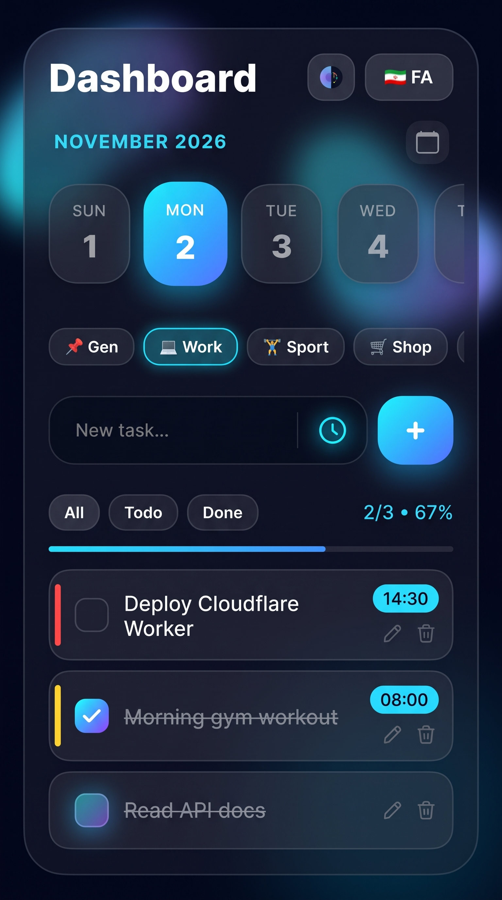

# Smart Planner & Telegram Reminder Bot


**Plan your day anywhere, and let Telegram ping you right on time.**

A zero-cost, serverless **Daily Planner & Smart Reminder System** powered by **Cloudflare Workers** and **Cloudflare D1**. Organize timed reminders and daily goals through a sleek **Telegram Mini App**, an **installable Mobile/Desktop PWA**, or **quick Telegram chat messages**—and get instant, interactive Telegram alerts with **Done** and **Snooze** buttons the moment a task is due.

> 🇮🇷 [معرفی و راهنمای نصب فارسی](#-معرفی-و-راهنمای-فارسی)

---

## How It Works

1. **Plan your tasks** in the Mini App, installed PWA, or by texting the bot directly (e.g., `Gym workout 18:30 sport`).
2. **Cloudflare Cron** monitors your schedule in the background every minute using delay-resilient logic (`<=` time check so no reminder is ever skipped).
3. **Telegram notifies you on time** with an interactive reminder card—mark it **Done** right from the notification, or **Snooze** it for `+15 min` or `+1 hour`.
4. **Everything stays 100% synced** across Telegram Chat, Mini App, and the standalone PWA in real time.

---

## Key Features

- **On-Time Telegram Reminders & Interactive Snooze**: Automatic push notifications in Telegram with inline `✅ Done`, `⏰ +15 min`, and `⏳ +1 hour` buttons.
- **Timed & Untimed Daily Tasks**: Schedule exact reminder times or add untimed to-dos for your daily checklist.
- **3 Glassmorphism Themes**: Switch instantly between **Aurora** (dark cyan), **Day** (clean frosted light), and **Midnight** (AMOLED violet).
- **Bilingual Interface (FA / EN)**: Full RTL/LTR support with automatic Persian (Jalali) and Gregorian date formatting.
- **One-Click Auto Setup (`/setup`)**: Automatically creates D1 tables & indexes, runs schema migrations, binds the Telegram Webhook, registers all Bot Commands, and sets the Mini App Menu Button—zero CLI or BotFather manual setup needed.
- **Secure Hybrid Auth**:
  - **Telegram Mini App**: Cryptographic `HMAC-SHA256` verification of `X-Telegram-Init-Data`.
  - **Web & Installed PWA**: One-time login via `/web` Magic Link or `WEB_PIN` with 365-day signed sessions and silent sliding auto-refresh.
- **Habits, Priorities & Progress**: Edit tasks anytime, assign priority levels (Normal / Medium / High), enable Daily/Weekly recurring tasks, filter by status, track your daily progress bar, and celebrate 100% completion with Confetti.
- **Smart Rollover, Stats & Auto-Cleanup**: Move yesterday's unfinished tasks to today in one click (`/rollover`), view 7-day productivity & streaks (`/stats`), and automatically purge tasks older than 30 days at `03:00`.

---

## Screenshots

| Aurora Theme | Day Theme |
| :---: | :---: |
|  |  |

---

## Quick Deployment (Cloudflare Dashboard — Zero CLI)

1. **Create a Bot**: Message `@BotFather` with `/newbot` and copy your `BOT_TOKEN`. Get your numeric Telegram ID from `@userinfobot`.
2. **Create a D1 Database**: In Cloudflare Dashboard, go to **Workers & Pages → D1 SQL Database** and create an empty database (e.g., `smart-planner-db`).
3. **Create a Worker**: Create a new Worker, paste the contents of `src/index.js`, and deploy.
4. **Bind Database**: Go to Worker **Settings → Bindings → Add → D1 Database**, set Variable name to **`DB`**, and select your database.
5. **Enable Reminder Engine (Cron)**: Go to **Settings → Trigger Events → Cron Triggers** and add `* * * * *`.
6. **Configure Environment Variables** (**Settings → Variables and Secrets**):

| Variable | Type | Required | Default | Description |
| :--- | :--- | :---: | :--- | :--- |
| `BOT_TOKEN` | Secret | Yes | — | Telegram Bot API token |
| `ADMIN_CHAT_ID` | Text | Yes | — | Your numeric Telegram ID (comma-separated for multiple) |
| `WEB_PIN` | Secret | No | — | Optional PIN for one-time PWA/Web sign-in |
| `WEBHOOK_SECRET` | Secret | No | — | Random string (`A-Z`, `a-z`, `0-9`, `_`, `-`) to protect `/webhook` |
| `TIMEZONE` | Text | No | `Asia/Tehran` | IANA timezone for reminders & daily schedules |
| `PUBLIC_MODE` | Text | No | `false` | Set `true` to allow any Telegram user to use the bot |
| `DISABLE_WEB_AUTH` | Text | No | `false` | Set `true` to open Web/PWA without login screen (personal use) |

7. **Run One-Click Setup**: Open `https://your-worker.workers.dev/setup`, enter your `ADMIN_CHAT_ID`, and click **Run Setup**. D1 tables, Webhook, Bot Commands, and the Mini App button will be configured automatically.

---

## CLI Deployment (Wrangler)

```bash
npm install
npx wrangler d1 create smart-planner-db
# Copy the generated database_id into wrangler.toml
npx wrangler secret put BOT_TOKEN
npx wrangler secret put ADMIN_CHAT_ID
npm run deploy
```

Then visit `https://your-worker.workers.dev/setup` once to initialize everything.

---

## Bot Commands & Quick Chat Entry

| Command | Action |
| :--- | :--- |
| `/start` | Launch welcome screen & Mini App button |
| `/tasks` / `/today` | View & manage today's tasks with inline buttons |
| `/tomorrow` | View tomorrow's tasks |
| `/rollover` | Move unfinished tasks from yesterday to today |
| `/stats` | 7-day completion rate, category breakdown & streak |
| `/web` | Get one-time Magic Link & token for Web / PWA |
| `/setup` | Auto-sync D1 schema, bot commands & menu button |
| `/help` | Quick syntax guide |

**Quick Add via Telegram Chat** — just send a message:
- `Team meeting 10:30 work` *(timed reminder in Work category)*
- `Gym workout 18:00 sport` *(timed reminder in Sport category)*
- `Buy groceries shop` *(untimed daily task)*

---

## 🇮🇷 معرفی و راهنمای فارسی

**Smart Planner** یک برنامه‌ریز روزانه و **سیستم یادآور هوشمند روی تلگرام** است که به صورت کاملاً رایگان و سرورلس روی **Cloudflare Workers** و دیتابیس **D1** اجرا می‌شود. کارهای زمان‌دار یا روزانه‌تان را از داخل مینی‌اپ تلگرام، اپلیکیشن نصبی (PWA) یا مستقیم در چت ربات ثبت کنید تا ربات **دقیقاً سر ساعت در تلگرام به شما پیام یادآوری بدهد** (همراه با دکمه‌های شیشه‌ای «انجام شد»، «۱۵ دقیقه بعد» و «۱ ساعت بعد»).

### ویژگی‌های شاخص
- **یادآور دقیق و ضدتاخیر در تلگرام** با دکمه‌های Snooze و تکمیل مستقیم از داخل اعلان
- **۳ تم مدرن** (Aurora، Day و Midnight) با رابط کاربری دوزبانه (فارسی/انگلیسی) و تقویم اسلایدی
- **راه‌اندازی یک‌کلیکه (`/setup`)**: ساخت خودکار جداول دیتابیس D1، تنظیم Webhook، ثبت منوی دستورات و فعال‌سازی دکمه مینی‌اپ بدون نیاز به ترمینال یا BotFather
- **مدیریت کامل تسک‌ها**: ویرایش، اولویت‌بندی، کارهای تکرارشونده (روزانه/هفتگی)، انتقال ناتمام‌های دیروز (`/rollover`)، گزارش عملکرد هفتگی (`/stats`) و پاکسازی خودکار تسک‌های قدیمی‌تر از ۳۰ روز

### نصب سریع در ۴ قدم
1. یک دیتابیس خالی در **Cloudflare D1** بسازید و در تنظیمات ورکر با نام دقیق **`DB`** متصل (Bind) کنید.
2. کد فایل `src/index.js` را در ورکر خود قرار دهید و **Cron Trigger** را روی `* * * * *` تنظیم کنید.
3. متغیرهای `BOT_TOKEN` و `ADMIN_CHAT_ID` (و به صورت اختیاری `WEB_PIN` و `WEBHOOK_SECRET`) را در بخش **Variables and Secrets** ذخیره و Deploy کنید.
4. آدرس `https://your-worker.workers.dev/setup` را در مرورگر باز کنید و آیدی عددی خود را بزنید تا دیتابیس، وب‌هوک، لیست دستورات و دکمه مینی‌اپ به صورت خودکار ساخته شوند.

---

## License

MIT License © 2026 [DIAKODE](https://github.com/DIAKODE)
