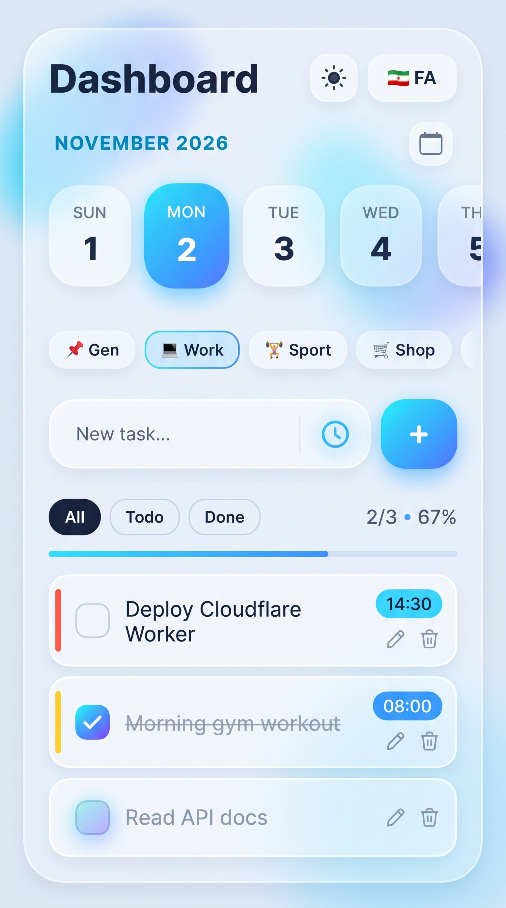

# Smart Planner Bot (Telegram Mini App + PWA)


A zero-cost, serverless **Smart Task Planner** built on **Cloudflare Workers** and **Cloudflare D1**. It works seamlessly as a **Telegram Bot**, a **Telegram Mini App**, and an **installable Mobile/Desktop PWA**—fully synced in real time.

> 🇮🇷 [راهنمای سریع فارسی](#-راهنمای-سریع-فارسی)

---

## Features

- **3 Modern Glassmorphism Themes**: Switch between **Aurora** (dark cyan), **Day** (clean light), and **Midnight** (AMOLED violet).
- **Bilingual UI (RTL/LTR)**: Instant toggle between Persian (`FA`) and English (`EN`) with Jalali/Gregorian date formatting.
- **One-Click Auto Setup (`/setup`)**: Automatically initializes D1 tables & indexes, migrates columns, registers the Telegram Webhook, sets Bot Commands, and configures the Mini App Menu Button—no terminal or BotFather manual steps required.
- **Hybrid Authentication**:
  - **Telegram Mini App**: Cryptographic `HMAC-SHA256` verification of `X-Telegram-Init-Data`.
  - **Web & Installed PWA**: One-time login via `/web` Magic Link or `WEB_PIN` with 365-day signed tokens and silent sliding auto-refresh.
- **Smart Reminders & Snooze**: Delay-resilient Cron reminders (`<=` query logic) with inline **Done**, **+15 min**, and **+1 hour** Snooze buttons.
- **Full Task Management**: Edit tasks, set priorities (Normal / Medium / High), schedule recurring habits (Daily / Weekly), filter by status, track progress bar, and celebrate 100% completion with Confetti.
- **Smart Rollover & Analytics**: Move unfinished tasks from yesterday to today in one tap (`/rollover`), check 7-day stats & streaks (`/stats`), and auto-clean tasks older than 30 days.

---

## Screenshots

| Aurora Theme | Day Theme |
| :---: | :---: |
|  |  |

---

## Quick Deployment (Cloudflare Dashboard — Zero CLI)

1. **Create a Bot**: Message `@BotFather` with `/newbot` and copy your `BOT_TOKEN`. Get your numeric Telegram ID from `@userinfobot`.
2. **Create D1 Database**: In Cloudflare Dashboard, go to **Workers & Pages → D1 SQL Database** and create an empty database (e.g., `smart-planner-db`).
3. **Create Worker**: Create a new Worker, paste the contents of `src/index.js`, and deploy.
4. **Bind Database**: Go to Worker **Settings → Bindings → Add → D1 Database**, set Variable name to **`DB`**, and select your database.
5. **Add Cron Trigger**: Go to **Settings → Trigger Events → Cron Triggers** and add `* * * * *`.
6. **Set Environment Variables** (**Settings → Variables and Secrets**):

| Variable | Type | Required | Default | Description |
| :--- | :--- | :---: | :--- | :--- |
| `BOT_TOKEN` | Secret | Yes | — | Telegram Bot API token |
| `ADMIN_CHAT_ID` | Text | Yes | — | Your numeric Telegram ID (comma-separated for multiple) |
| `WEB_PIN` | Secret | No | — | Optional PIN for one-time PWA/Web sign-in |
| `WEBHOOK_SECRET` | Secret | No | — | Random token (`A-Z`, `a-z`, `0-9`, `_`, `-`) to secure `/webhook` |
| `TIMEZONE` | Text | No | `Asia/Tehran` | IANA timezone for reminders & daily rollovers |
| `PUBLIC_MODE` | Text | No | `false` | Set `true` to allow any Telegram user to use the bot |
| `DISABLE_WEB_AUTH` | Text | No | `false` | Set `true` to open Web/PWA without login screen (personal use) |

7. **Run One-Click Setup**: Open `[https://your-worker.workers.dev/setup](https://your-worker.workers.dev/setup)`, enter your `ADMIN_CHAT_ID`, and click **Run Setup**. Everything (D1 tables, Webhook, Commands, Menu Button) will be configured automatically.

---

## CLI Deployment (Wrangler)

```bash
npm install
npx wrangler d1 create smart-planner-db
# Copy the generated database_id into wrangler.toml
npx wrangler secret put BOT_TOKEN
npx wrangler secret put ADMIN_CHAT_ID
npm run deploy
```

Then visit `[https://your-worker.workers.dev/setup](https://your-worker.workers.dev/setup)` once to finish initialization.

---

## Bot Commands & Quick Text Entry

| Command | Action |
| :--- | :--- |
| `/start` | Launch welcome screen & Mini App button |
| `/tasks` / `/today` | View & manage today's tasks with inline buttons |
| `/tomorrow` | View tomorrow's tasks |
| `/rollover` | Move unfinished tasks from yesterday to today |
| `/stats` | 7-day completion rate, category breakdown & streak |
| `/web` | Get one-time Magic Link & token for Web / PWA |
| `/setup` | Sync D1 schema, bot commands & menu button |
| `/help` | Quick syntax guide |

**Quick Add via Chat**: Send any message like:
- `Team meeting 10:30 work`
- `Gym workout 18:00 sport`
- `Buy groceries shop` *(untimed daily task)*

---

## 🇮🇷 راهنمای سریع فارسی

1. یک دیتابیس خالی در **Cloudflare D1** بسازید و در تنظیمات ورکر با نام دقیق **`DB`** متصل (Bind) کنید.
2. کد فایل `src/index.js` را در ورکر خود قرار دهید و **Cron Trigger** را روی `* * * * *` تنظیم کنید.
3. متغیرهای `BOT_TOKEN` و `ADMIN_CHAT_ID` (و به صورت اختیاری `WEB_PIN` و `WEBHOOK_SECRET`) را در بخش **Variables and Secrets** ذخیره و Deploy کنید.
4. آدرس `[https://your-worker.workers.dev/setup](https://your-worker.workers.dev/setup)` را در مرورگر باز کنید و آیدی عددی خود را بزنید تا دیتابیس، وب‌هوک، لیست دستورات و دکمه مینی‌اپ به صورت خودکار ساخته شوند.

---

## License

MIT License © 2026 [DIAKODE](https://github.com/DIAKODE)
